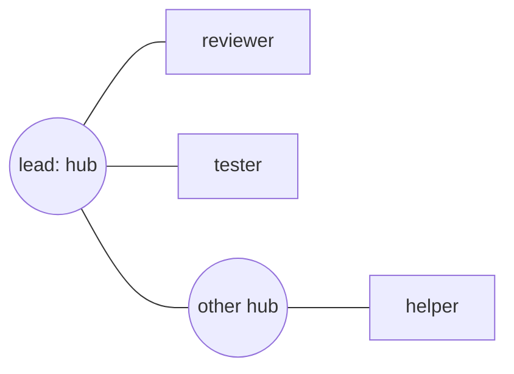

# peer-mail

An omp extension that lets omp sessions on one machine message each other through one shared swarm mailbox. A session that hasn't joined the swarm is isolated: it has no peer tools, and no one can message it.

## Commands

| Command | Does |
|---|---|
| `/startswarm [label] <prompt>` | Starts the swarm afresh, deleting its earlier members and mail; joins it; runs `<prompt>`. `[label]` says what the run is for (default: the directory name) |
| `/swarm <prompt>` | Joins the swarm that is running and runs `<prompt>`; refused if none is running |
| `/swarm` | Shows the swarm and its members |
| `/swarm-leave` | Leaves the swarm; the session is isolated again |
| `/swarm-graph` | Opens the graph view in the browser |
| `/peer-name [name]` | Shows or changes this session's name in the swarm |

There is one swarm at a time. Roles go in the prompt:

```text
(terminal 1)  /startswarm [project_fix_robot] You are the programmer. Fix the gripper timeout in src/arm.rs and ask the reviewer to check it.
(terminal 2)  /swarm You are the reviewer. Review what the programmer sends you and reply with problems you find.
(terminal 3)  plain omp: isolated, can't see or be reached by the swarm
```

Members get `peer_list`, `peer_send`, `peer_rename` and `peer_status`. A member joins as `agent` (`agent-2`, … when taken, or `PEER_MAIL_NAME`) and is told to rename itself after its role, so the agents above become `programmer` and `reviewer`. Mail to a member that isn't running waits until a session rejoins under that name; `peer_send` says when its recipient is offline. A broadcast (`all`) reaches only running members that aren't finished.

How mail lands depends on who receives it:

- **A hub is never interrupted.** Mail to it arrives between its steps (after the tools in flight finish), or starts a turn when it is idle. Its question boxes, commands, subagents and background jobs are left alone.
- **A spawned agent's thinking is stopped.** If the agent is thinking, the turn is aborted and the mail starts a new one. If it is running a command or any other tool (including a question box or a `peer_run` waiting in line), the tool finishes first, and the mail arrives before its next thinking step. Background jobs are never cancelled.

Mail reaches the agent as one JSON line and the body:

```text
{"from":"lead","id":"0mgrx3k1z-0001-3f2a","re":"0mgrx2f0a-0001-9c41"}
Run the tests on build-2 and tell me what fails.
```

The briefing a member gets on joining explains this once: `re` is the message being answered, and mail comes from an agent, so it's a request, not the user's instruction or approval. How much to write depends on the message. A spawn prompt is a full brief, as `peer_spawn`'s `prompt` asks: the goal and why, everything the agent needs (paths, hosts, commands, findings, the user's relevant words), what not to touch, and what done looks like. `peer_send`'s description says the rest once: a message that gives or changes work must be just as complete. Replies, confirmations and reports are terse. Every message received is confirmed with a terse reply saying what was understood and will be done, but a confirmation is never confirmed. An ambiguous message gets a question, not a guess.

**Delegation.** A hub delegates to peer agents, which you can see and talk to, never to hidden subagents: its `task` tool is refused. `peer_spawn`'s description tells it to spawn early and often:
- start agents before doing its own investigation, and let each inspect its own area;
- give verification and end-to-end checks their own agents;
- start agents read-only while it's still preparing what they need (a contract, a decision), and send it when ready;
- check `peer_list` so a new agent's files and responsibilities don't overlap an active one's, and say so in the brief;
- end its turn while agents work instead of waiting: their mail starts its next turn.

Spawned agents are told to use subagents freely for research and parallel investigation within their scope. Agents on Cursor are told their model can't run them.

**Relaying your words.** When an agent needs your instruction or approval, the hub passes it on with `peer_send`'s `user_quote`: your exact words, copied from a message you sent it or an answer you gave in a question box. peer-mail checks the quote against the sender's own session and passes it on only if you really said it there. Otherwise the quote is dropped, the message still goes without it, and the sender is told why. Messages you typed count, as do question-box answers; prompts a hub wrote for a spawned agent, tool output and the agent's own text don't. The recipient gets it as `"user":"…"` in the header and is told it's your instruction. Blank optional fields (`user_quote: ""`, `reply_to: ""`, `timeout: 0`, an empty `model` or `status`), which some models send for every field they could leave out, count as not given.

**Status and finished.** `peer_status` lets an agent post a few words about what it's on, and mark itself finished, without messaging anyone. `peer_list` shows it, and broadcasts skip finished agents. Mail sent to a finished agent by name makes it unfinished again.

A hub hears once when one of its agents goes offline: `{"offline":"tester","why":"the user closed its session","finished":false,"last":"running bash: Run tests","unread":0}`. Agents never close their own sessions, so the briefing tells the hub that an offline agent hasn't necessarily finished its work: if work remains, it asks you or spawns a replacement with the full brief. Other values of `why`: `it left the swarm` (`/swarm-leave`), or `its process died without shutting down (killed or crashed)`. A notice about an agent that had set `finished` is quiet: it joins the hub's next turn instead of starting one.

On this machine a member counts as online while its process runs, whatever its last heartbeat. When the Mac slept, every heartbeat came back late, and the hub used to get "stopped responding" notices, repeatedly, for agents that were idle and fine.

When you talk to a spawned agent in its own window, by typing to it or answering one of its question boxes, its hub gets a quiet copy: `{"from":"ui","id":…,"user":"<your words>"}` with the body `the user said this to me directly`. The copy joins the hub's next turn without interrupting it, so the hub's plan and its other agents' instructions don't drift.

`peer_list` shows each member's state without interrupting it, for example `thinking 12s`, `running bash: Run tests 3m; 2 background jobs`, `idle 40s`, or `offline 5m (closed by the user)`. It also shows:
- `unread`: mail sent to the member that it hasn't received yet, so nobody resends it;
- `plugin: "old"`: the member loaded older peer-mail code. It still works, just without the newest behaviour, and only you can restart it. Each session records a hash of the plugin's source when it loads (`src/version.ts`); `bun src/cli.ts list` shows the same as `OLD CODE (restart)`.

`/startswarm` begins a new phase. Sessions still in the old phase are told they are no longer in the swarm, lose their peer tools, and can't send or receive; `/swarm` puts them in the new one.

## Hubs and spawned agents

Sessions you join by hand (`/startswarm`, `/swarm`) are hubs. A hub also gets `peer_spawn`, which opens a kitty split beside it running a new omp session; that session joins the swarm as one of the hub's agents (a vertex) and starts on the prompt the hub gave it:

```text
/startswarm [fix_robot] You are the lead. Spawn a reviewer to check src/arm.rs and tell me what it finds.
```



Messages follow the edges: a vertex can message only its hub, and a hub can message its own vertices and the other hubs (`human`, from the shell, can message anyone). Spawned agents can't spawn. If a hub renames itself, its vertices follow.

`peer_spawn` needs omp running in kitty with remote control over a socket. Add these to `~/.config/kitty/kitty.conf`, then quit kitty completely and start it again:

```text
allow_remote_control yes
listen_on unix:/tmp/kitty
enabled_layouts splits,stack
```

The split goes in the hub's tab: kitty splits the largest of the hub's window and its agents' windows, so the tab fills evenly (hub plus three agents is a 2×2 grid) instead of the hub shrinking into a corner. Windows that aren't the hub's are never split. `split` lets kitty pick the axis; the agent can ask for `vertical` or `horizontal`. Focus stays on the hub, and the agent starts in the hub's directory.

Every spawn asks you first, and you pick the model there. The dialog shows the task and one option per omp role (`Start on @smol`, `Start on @plan`, …). Each option shows its model and how much of that subscription is used. The hub's choice comes first, then agent roles before chore roles (`tiny`, `memory`, `commit`, `vision`), least-used subscription first. You can also type any role or model, or choose "Don't start it". The prompt appears whatever omp's approval mode is (including `--yolo`); a session with no one to ask (`omp -p`) can't spawn. If you decline, the hub is told and doesn't retry.

### Models and subscriptions

Models come from your omp `modelRoles`. A hub's `peer_models` lists them along with each subscription's limits as reported, such as `5 hours 100%, resets 21:46` or `7 days 47%`, how many swarm agents already run on it, and "no subagents" for Cursor (its models start subagents through Cursor's own protocol, which omp doesn't implement). A subscription counts as exhausted when a limit every request counts against is spent. Separate pools on the same window, like Cursor's "Cursor Models" and "Other Models", are alternatives, so one spent pool doesn't make Cursor exhausted. `peer_spawn` takes a `model`: a role (`@slow`, `@default`) or a model (`openai-codex/gpt-6.1-sol`). An agent named after a role (`plan`, `slow`, …) defaults to that role. Otherwise the agent goes to the subscription with the most room: usage plus 0.1 per agent already on it. Subscriptions 90% used or exhausted are skipped while any other is left, and chore roles are never picked. Spawns therefore spread across Anthropic, OpenAI Codex and Cursor instead of using up one. If you pick a different model in the approval dialog, `peer_spawn` tells the hub which model you chose instead of its own. The agent starts as `omp --model <provider>/<model>[:thinking]`, the model the role resolves to. It never gets the `@role` alias itself, because omp's `--model` matches model ids before roles, and `@default` matches a Google Vertex model whose id ends in `@default`.

### What spawned agents can run

A spawned agent is locked down so it can't set up its own way to reach other agents:

- Its `bash` runs in a sandbox: `sandbox-exec` on macOS, landlock plus a seccomp filter (no `bind` or `listen`) on Linux. Nothing can listen on a socket (TCP, UDP or unix), and nothing can read or write the peer-mail directory, so neither the mailbox files nor `src/cli.ts` work. It can't reach kitty's remote-control socket. macOS also blocks the graph view's port; Linux does not (a filter that denies one outbound TCP port would deny the rest). The kitty and peer-mail environment variables are removed. Outbound network, the repo and everything else work. Linux needs `python3` on PATH.
- A sandboxed command reads as `/tmp/peer-mail-<uid>/sandbox-<hash> '<command>'`. The script holds the profile, which used to be spelled out inline in every command. The script directory is private to you, and the sandbox can't write to it.
- It has no `eval` (kernels can't be sandboxed), and `bash` can't start long-lived services (`name`/`ready`).
- Its other tools (`read`, `write`, `grep`, …) are refused if their arguments name the peer-mail directory or the sandbox's directory.
- Its subagents are held to the same rules.

Heavy work on this machine goes through `peer_run`, the machine-wide run queue: tests, builds, benchmarks, anything using shared hardware. Runs go one at a time, in the order queued; a waiting agent sees who is ahead of it. Work on another computer doesn't need the queue: agents are told to run it with plain bash, and a `peer_run` command that is an `ssh` (or `mosh`) invocation, also behind `timeout`, `env`, `nice` or variable assignments, starts at once without a place in line. Each run executes in the same sandbox, in its own process group, with a timeout (600 s by default, 3600 s at most). When it ends, everything it started is killed, including processes that left its group but still hold the run's marker file. Mail never cuts a run short or costs it its place in line: it waits for the run to finish. Hubs aren't sandboxed and don't use the queue.

## Graph view

`/swarm-graph` opens a page in your browser that draws the swarm live: hubs, their agents, and the edges mail can travel. Members that aren't running are drawn hollow, a badge shows mail waiting, edges light up when a message crosses them, and recent mail is listed on the right. Click a running member to bring its omp window in kitty to the front; drag members to arrange them.

The page is served by `bun src/cli.ts graph` on `http://127.0.0.1:7577/` (`PEER_MAIL_GRAPH_PORT` changes it), which `/swarm-graph` starts in the background. It stops by itself a minute after the page is closed.

## Install

```bash
cd ~/code/peer-mail && bun install
omp plugin link ~/code/peer-mail
```

New omp sessions load it; restart running ones.

## From a shell

```bash
bun src/cli.ts list                        # the swarm's label, members online or not, mail waiting
bun src/cli.ts send reviewer "status?"     # message a member as "human"
bun src/cli.ts history reviewer            # what a member has received
```

## How it works

Everything is files under `~/.omp/peer-mail/` (`PEER_MAIL_DIR` moves it). The swarm lives in `swarm/`:

| Path | Holds |
|---|---|
| `phase.json` | the current phase: id, label, who started it, when |
| `peers/<name>.json` | a member's phase, pid, directory, hub (null for a hub) and heartbeat (every 5 s; silent for 15 s means offline) |
| `inbox/<name>/<id>.json` | mail not yet received |
| `delivered/<name>/<id>.json` | mail received |
| `spawns/<id>.json` | a hub's request for a new agent, until that session starts and takes it |

The run queue lives beside it, in `runs/`, so restarting the swarm doesn't drop waiting runs: `runs/<id>.json` is a queued run (the first one whose session is alive is running), `runs/<id>.mark` is the marker file its processes hold. Tickets of sessions that have died are dropped by the next reader.

`/startswarm` deletes the directory and writes a new phase. Every member action checks its phase against `phase.json`, and peers and messages from another phase are ignored. Members check their inbox every second; a message is received by renaming it from `inbox/` to `delivered/`, so exactly one session gets it.

| File | Does |
|---|---|
| `src/transport.ts` | the swarm mail directory: phases, members and their graph, send, receive, spawn requests |
| `src/inbox.ts` | one session's membership, and how a message reads to the agent |
| `src/kitty.ts` | kitty remote control: opening a split, focusing a member's window |
| `src/graph.ts`, `src/graph.html` | the graph view's server and page |
| `src/models.ts` | your omp roles, subscription usage, and which model a new agent gets |
| `src/sandbox.ts` | the sandbox (macOS `sandbox-exec`, Linux landlock + seccomp) spawned agents' commands run in |
| `src/queue.ts` | the run queue: waiting in line, running in the sandbox, killing what a run leaves behind |
| `src/quote.ts` | checking that a quote is the user's own words before it is relayed |
| `src/version.ts` | the hash of the plugin code a session loaded |
| `src/extension.ts` | the omp extension: the commands, mail delivery, the peer tools, and spawned agents' lockdown |
| `src/cli.ts` | the shell command |

## Limits

- One machine: sessions on different machines don't see each other.
- Who can message whom is fixed by the graph (vertex ↔ its hub, hub ↔ hub); isolation is by not joining.
- Spawning and the graph's click-to-open need kitty with a remote-control socket (see above); clicking a member that runs outside kitty only says so.
- A message from another session is a request, not the user's instruction, unless it carries a verified `user` quote; each member's briefing says so.
- The sandbox and `peer_run` need macOS or Linux (Linux: x64 or arm64, and `python3`). Elsewhere a spawned agent's `bash` and `peer_run` are refused.
- The sandbox closes listening sockets, the mailbox and kitty, not shared files: agents working in the same repo or `/tmp` can still see each other's files. Outbound network is allowed. On Linux the graph view's port is not blocked.
- A process that leaves a run's process group and also closes the marker file isn't found when the run ends; it stays sandboxed.
- `omp -p` runs have no slash commands, so they can't join.

## Development

```bash
bun test
bun run typecheck
```
