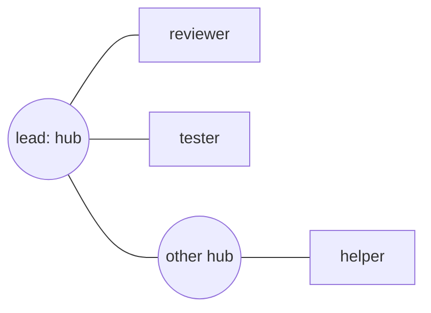

# peer-mail

An omp extension that lets omp sessions on one machine message each other through one shared swarm mailbox. A session that hasn't joined the swarm is isolated: it has no peer tools, and no one can message it.

## Commands

| Command | Does |
|---|---|
| `/startswarm [label] <prompt>` | Starts the swarm afresh, deleting its earlier members and mail; joins it; runs `<prompt>`. `[label]` says what the run is for (default: the directory name) |
| `/swarm <prompt>` | Joins the swarm that is running and runs `<prompt>`; refused if none is running |
| `/swarm` | Shows the swarm and its members |
| `/swarm-leave` | Leaves the swarm; the session is isolated again |
| `/swarm-graph` | Opens the graph view in the browser |
| `/peer-name [name]` | Shows or changes this session's name in the swarm |

There is one swarm at a time. Roles go in the prompt:

```text
(terminal 1)  /startswarm [project_fix_robot] You are the programmer. Fix the gripper timeout in src/arm.rs and ask the reviewer to check it.
(terminal 2)  /swarm You are the reviewer. Review what the programmer sends you and reply with problems you find.
(terminal 3)  plain omp: isolated, can't see or be reached by the swarm
```

Members get `peer_list`, `peer_send` and `peer_rename`. A member joins as `agent` (`agent-2`, … when taken, or `PEER_MAIL_NAME`) and is told to rename itself after its role, so the agents above become `programmer` and `reviewer`. Mail to a member that isn't running waits until a session rejoins under that name.

Mail interrupts its recipient. If the recipient is working, its turn is aborted along with the commands and eval it is running (the same as pressing Esc), and the mail starts a new turn once it has stopped; an idle recipient just starts a turn. Background jobs (`async` bash, background subagents) can't be cancelled from an extension, so the delivered mail lists any still running and tells the agent to stop them first with `write proc://<id>/kill`.

`/startswarm` begins a new phase. Sessions still in the old phase are told they are no longer in the swarm, lose their peer tools, and can't send or receive; `/swarm` puts them in the new one.

## Hubs and spawned agents

Sessions you join by hand (`/startswarm`, `/swarm`) are hubs. A hub also gets `peer_spawn`, which opens a kitty split beside it running a new omp session; that session joins the swarm as one of the hub's agents (a vertex) and starts on the prompt the hub gave it:

```text
/startswarm [fix_robot] You are the lead. Spawn a reviewer to check src/arm.rs and tell me what it finds.
```



Messages follow the edges: a vertex can message only its hub, and a hub can message its own vertices and the other hubs (`human`, from the shell, can message anyone). Spawned agents can't spawn. If a hub renames itself, its vertices follow.

`peer_spawn` needs omp running in kitty with remote control over a socket. Add these to `~/.config/kitty/kitty.conf`, then quit kitty completely and start it again:

```text
allow_remote_control yes
listen_on unix:/tmp/kitty
enabled_layouts splits,stack
```

The split goes beside the hub's window (`split`: kitty picks the axis; the agent can ask for `vertical` or `horizontal`), keeps focus on the hub, and starts in the hub's directory.

Every spawn asks you first: the hub shows "Start a new agent "reviewer"?" with the task it would get, and nothing opens unless you choose Yes. This prompt appears whatever omp's approval mode is (including `--yolo`); a session with no one to ask (`omp -p`) can't spawn. If you decline, the hub is told and doesn't retry.

## Graph view

`/swarm-graph` opens a page in your browser that draws the swarm live: hubs, their agents, and the edges mail can travel. Members that aren't running are drawn hollow, a badge shows mail waiting, edges light up when a message crosses them, and recent mail is listed on the right. Click a running member to bring its omp window in kitty to the front; drag members to arrange them.

The page is served by `bun src/cli.ts graph` on `http://127.0.0.1:7577/` (`PEER_MAIL_GRAPH_PORT` changes it), which `/swarm-graph` starts in the background. It stops by itself a minute after the page is closed.

## Install

```bash
cd ~/code/peer-mail && bun install
omp plugin link ~/code/peer-mail
```

New omp sessions load it; restart running ones.

## From a shell

```bash
bun src/cli.ts list                        # the swarm's label, members online or not, mail waiting
bun src/cli.ts send reviewer "status?"     # message a member as "human"
bun src/cli.ts history reviewer            # what a member has received
```

## How it works

Everything is files under `~/.omp/peer-mail/swarm/` (`PEER_MAIL_DIR` moves the root):

| Path | Holds |
|---|---|
| `phase.json` | the current phase: id, label, who started it, when |
| `peers/<name>.json` | a member's phase, pid, directory, hub (null for a hub) and heartbeat (every 5 s; silent for 15 s means offline) |
| `inbox/<name>/<id>.json` | mail not yet received |
| `delivered/<name>/<id>.json` | mail received |
| `spawns/<id>.json` | a hub's request for a new agent, until that session starts and takes it |

`/startswarm` deletes the directory and writes a new phase. Every member action checks its phase against `phase.json`, and peers and messages from another phase are ignored. Members check their inbox every second; a message is received by renaming it from `inbox/` to `delivered/`, so exactly one session gets it.

| File | Does |
|---|---|
| `src/transport.ts` | the swarm mail directory: phases, members and their graph, send, receive, spawn requests |
| `src/inbox.ts` | one session's membership, and how a message reads to the agent |
| `src/kitty.ts` | kitty remote control: opening a split, focusing a member's window |
| `src/graph.ts`, `src/graph.html` | the graph view's server and page |
| `src/extension.ts` | the omp extension: the commands, mail delivery, and the peer tools |
| `src/cli.ts` | the shell command |

## Limits

- One machine: sessions on different machines don't see each other.
- Who can message whom is fixed by the graph (vertex ↔ its hub, hub ↔ hub); isolation is by not joining.
- Spawning and the graph's click-to-open need kitty with a remote-control socket (see above); clicking a member that runs outside kitty only says so.
- A message from another session is a request, not the user's instruction; the delivered text tells the agent so.
- Background jobs are stopped by the agent following the instruction in the mail, not by the extension itself (omp gives extensions no way to cancel them).
- `omp -p` runs have no slash commands, so they can't join.

## Development

```bash
bun test
bun run typecheck
```
